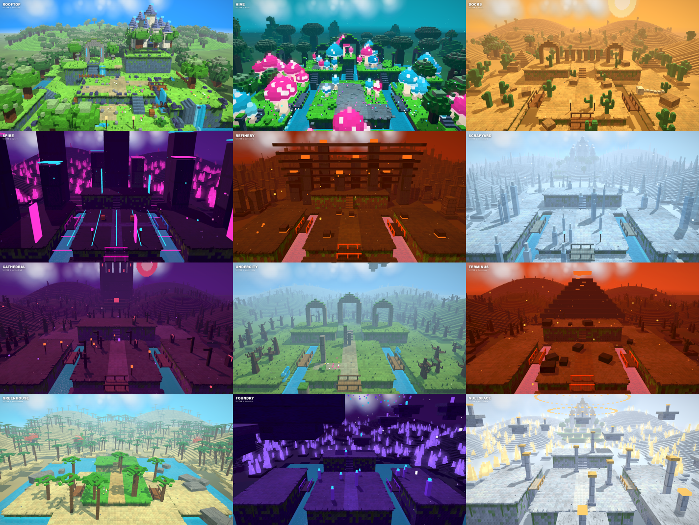
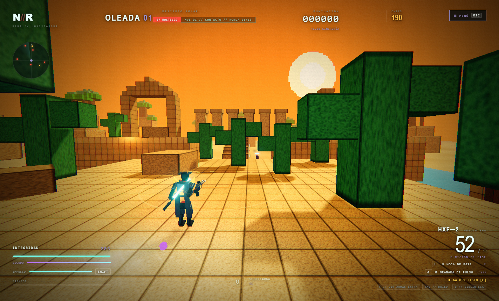

# NEON//REVENANT

> Arena shooter en tercera persona por oleadas, construido con Electron y Three.js.



## Que es

NEON//REVENANT es un juego de accion 3D en tercera persona: eliges un heroe,
sobrevives a oleadas de hostiles y vas construyendo tu build con habilidades,
evoluciones y reliquias. La interfaz, el combate y los efectos se generan en
codigo; los heroes, sus armas y los escenarios usan modelos GLB y kits de
piezas 3D estilo voxel incluidos en `assets/`.



## Contenido

- **5 heroes definitivos** (Vanta, Kira, Seraph, Ronin y Glitch), cada uno con
  modelo GLB propio y **un arma unica** con modelo y ancla de disparo reales.
- **Arbol de habilidades**, evoluciones y reliquias para construir tu build.
- **12 sectores** de progresion resueltos sobre **7 mundos** construidos con
  kits de piezas (naturaleza, nieve, minimercado, barrio, estacion, espacio y
  hexagono), con arquitectura modular (`src/worlds/`) y fallback voxel
  temporal para los mundos aun no implementados.
- **18 jefes** con fases y mecanicas propias; facciones, logros,
  modificadores, dificultades, tienda y records.
- Sistema de sonido real con Web Audio: banco de **124 efectos** (Kenney RPG
  Audio + Sci-Fi Sounds) y musica sintetizada en tiempo real.
- Particulas y proyectiles nuevos con object pooling, bloom y calidad
  grafica adaptativa.

## Requisitos

- **Node.js 20 o superior** (desarrollado y probado con Node 22) y npm.
- Electron se instala como dependencia de desarrollo con `npm install`.
- Windows, macOS o Linux con entorno grafico.

## Instalacion y ejecucion

```bash
git clone https://github.com/kegonzalezs/neon-revenant.git
cd neon-revenant
npm install
npm start
```

`npm start` lanza Electron apuntando a la raiz del proyecto. Tambien se puede
abrir `preview.html` en un navegador para ver las tarjetas de los sectores.

## Scripts

| Comando | Que hace |
| --- | --- |
| `npm start` | Inicia el juego |
| `npm run dev` | Inicia el juego con logging habilitado |
| `npm run check` | Comprueba la sintaxis de los modulos principales |
| `npm run dist` | Genera el instalador con electron-builder |
| `node scripts/start.cjs --smoke-test` | Pasada automatica de verificacion (requiere pantalla) |

## Estructura

```
index.html        Interfaz, menus y HUD
main.cjs          Proceso principal de Electron y utilidades de captura
preload.cjs       Puente de precarga (IPC)
src/game.js       Bucle de juego, combate y render
src/glb-character.js  Carga de los modelos GLB de los heroes
src/weapons.js    Arsenal unico por heroe (GLB + ancla de disparo)
src/combat-particles.js  Particulas de combate
src/combat-projectiles.js  Proyectiles con object pooling
src/sfx.js        Efectos de sonido (Web Audio)
src/operators.js  Cuerpos y balance de los operadores
src/content.js    Tablas de contenido: roster, sectores, habilidades
src/arsenal.js    Evoluciones y reliquias
src/worlds.js     Sectores y generacion de niveles (fallback voxel)
src/worlds/       Arquitectura modular: registry + builders de los 7 mundos
src/WorldManager.js  Gestor de construccion de mundos
src/style.css     Estilos y HUD
scripts/          Utilidades de prueba, captura y generacion de assets
assets/           Modelos GLB, audio, texturas, UI y fuentes
art/              Tarjetas de los sectores
docs/             Capturas que usa este README
```

## Notas

- El repositorio **no incluye** `node_modules/`, builds, las capturas de las
  pruebas ni `kenney_src/` (el pack fuente de piezas que usan los scripts de
  Python para generar los assets optimizados de `assets/worlds/`); todo eso
  se regenera en local.
- El lanzador `JUGAR.cmd` usado durante el desarrollo apunta a una instalacion
  local de Node y por eso no se versiona. En su lugar, usa `npm start`.
- Proyecto personal en desarrollo activo: puede haber cambios importantes entre
  versiones.

## Licencia

Pendiente de definir. Hasta que se indique lo contrario, todos los derechos
reservados.
